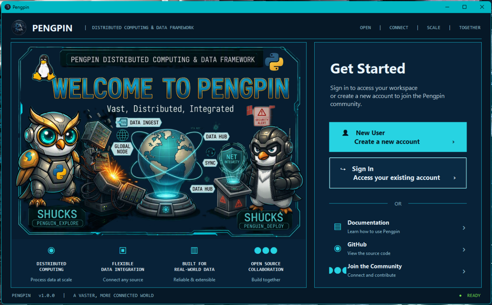
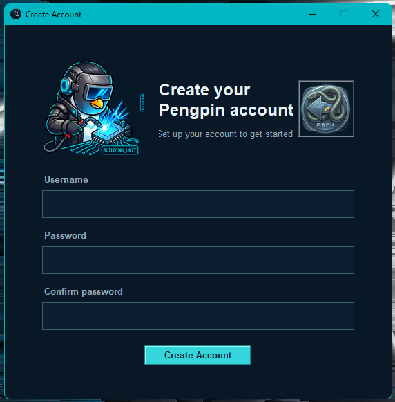
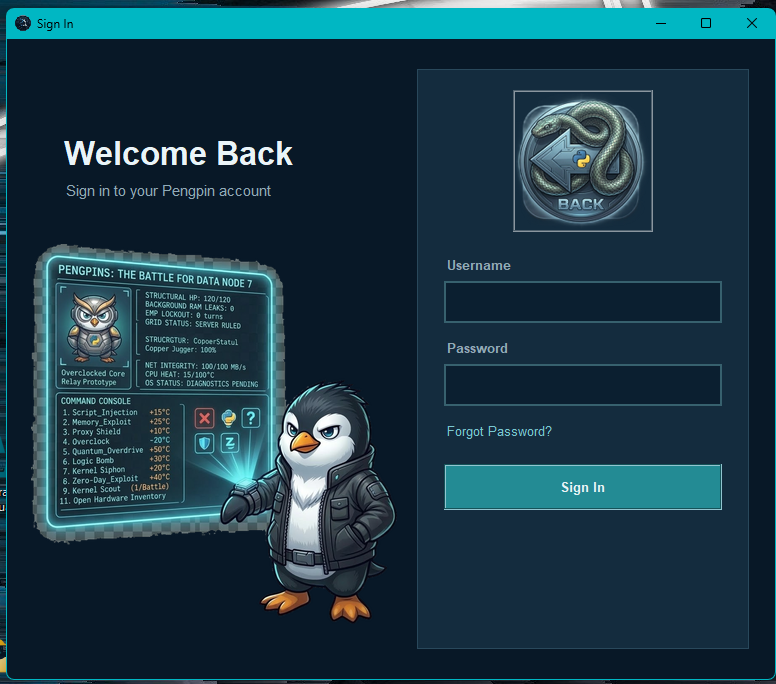
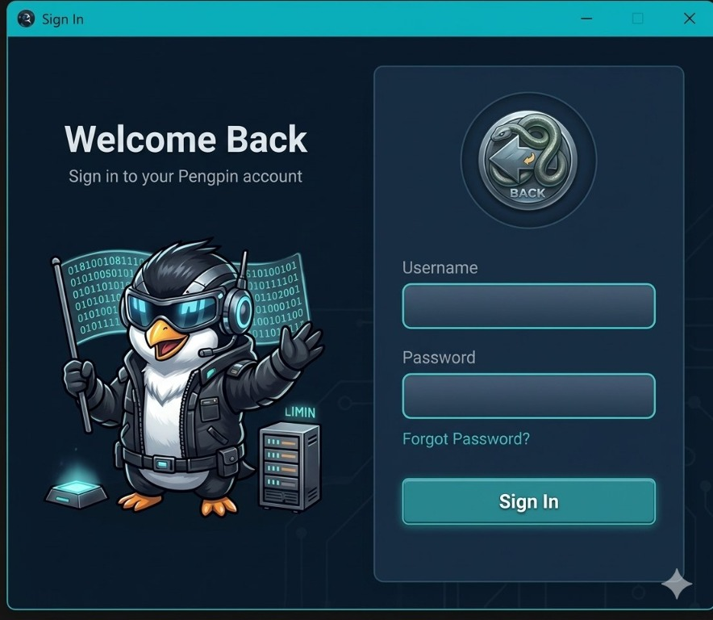
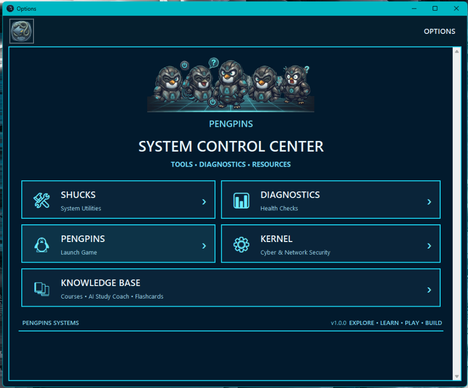
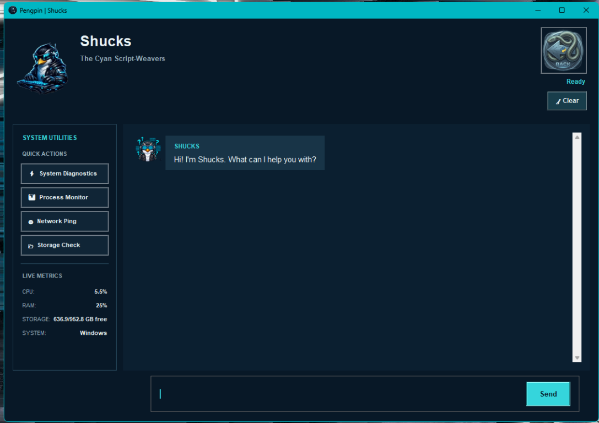
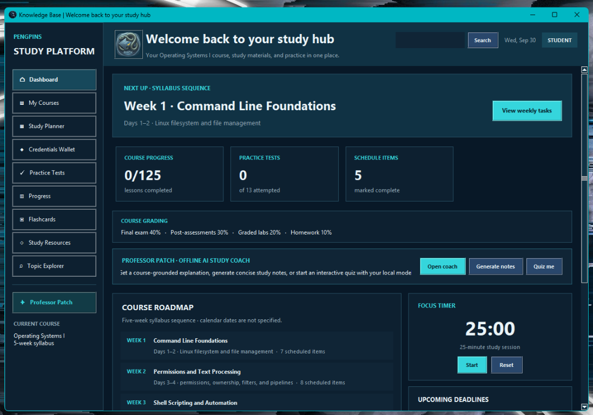
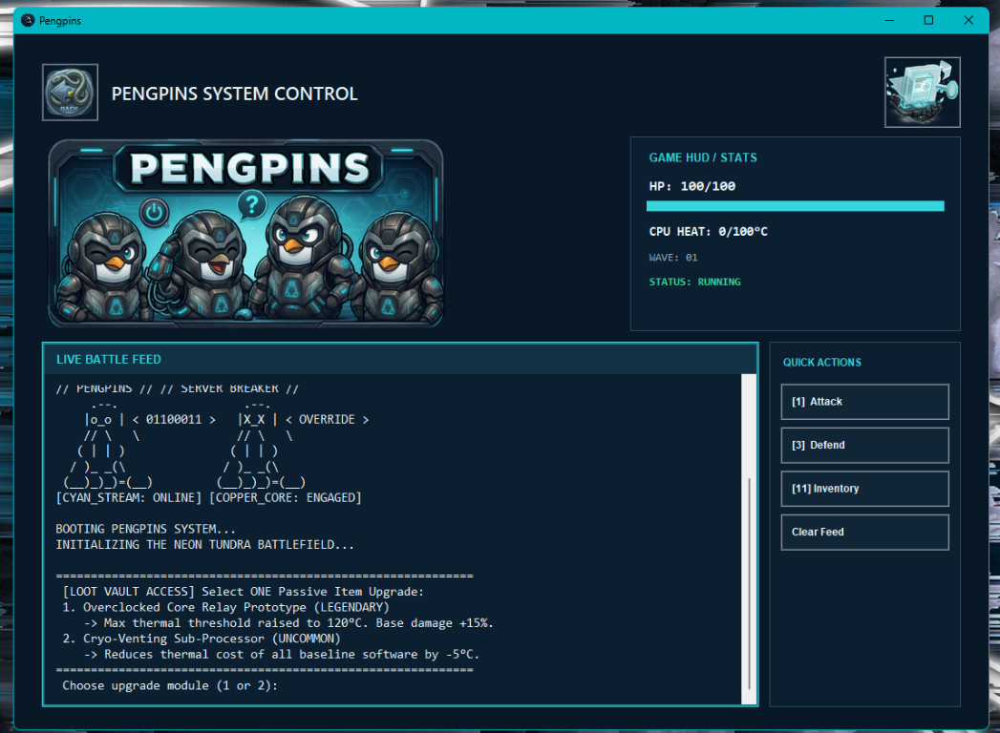
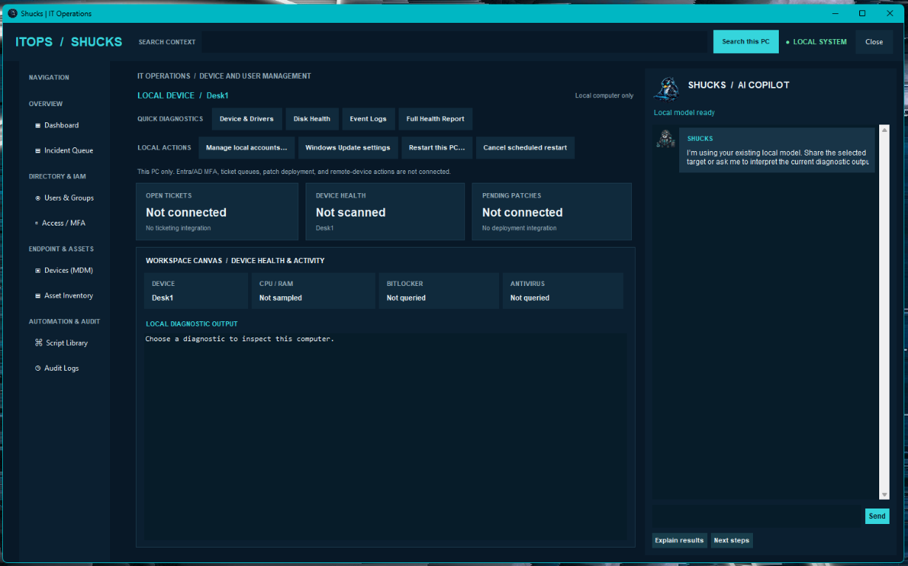
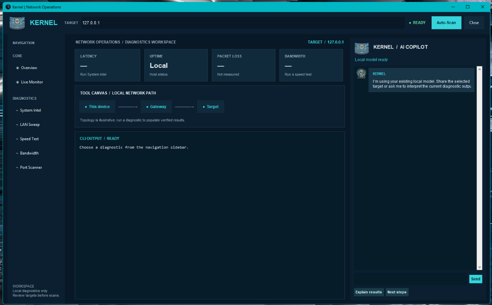

# Shucks Visual Tour

A visual companion to the [project README](README.md), showcasing the welcome flow, feature hub, and the main application workspaces.

## Welcome and account setup

| Welcome screen | Create account |
| --- | --- |
|  |  |

| Sign in | Alternate sign-in concept |
| --- | --- |
|  |  |

## Feature hub and assistant

| System Control Center | Shucks assistant |
| --- | --- |
|  |  |

## Study and play

| Knowledge Base | Pengpins |
| --- | --- |
|  |  |

## Diagnostics and networking

| Shucks IT Operations | Kernel Network Operations |
| --- | --- |
|  |  |
